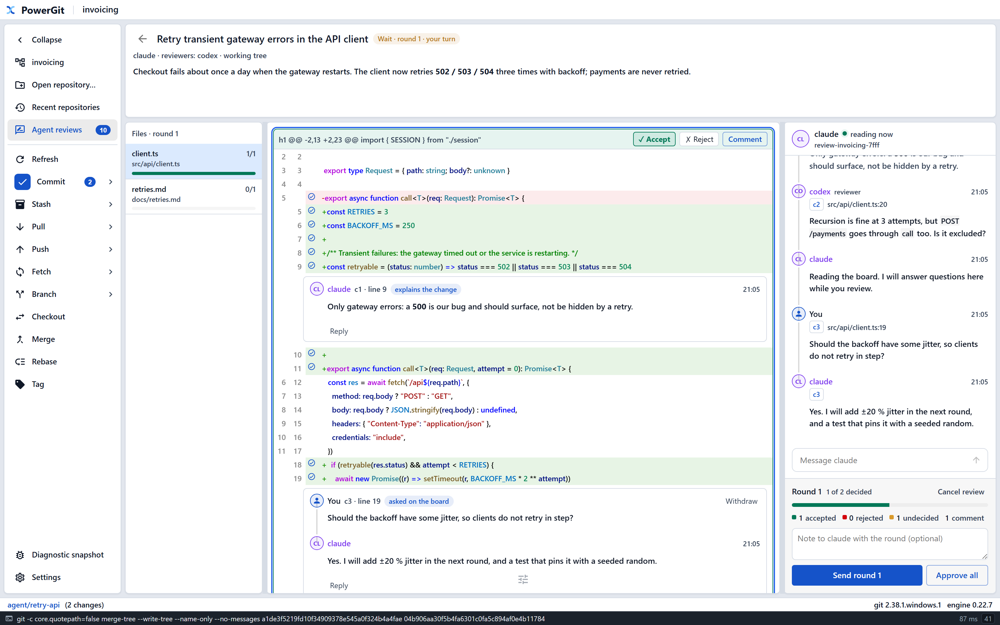
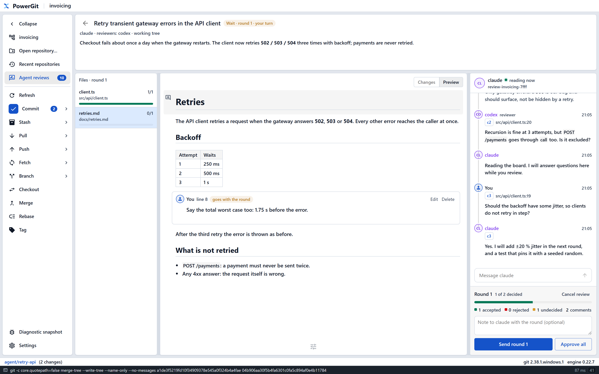
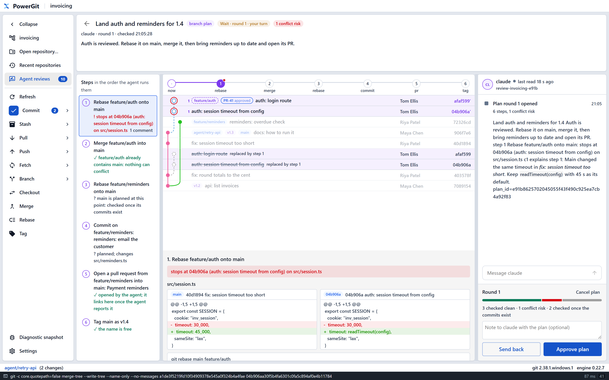
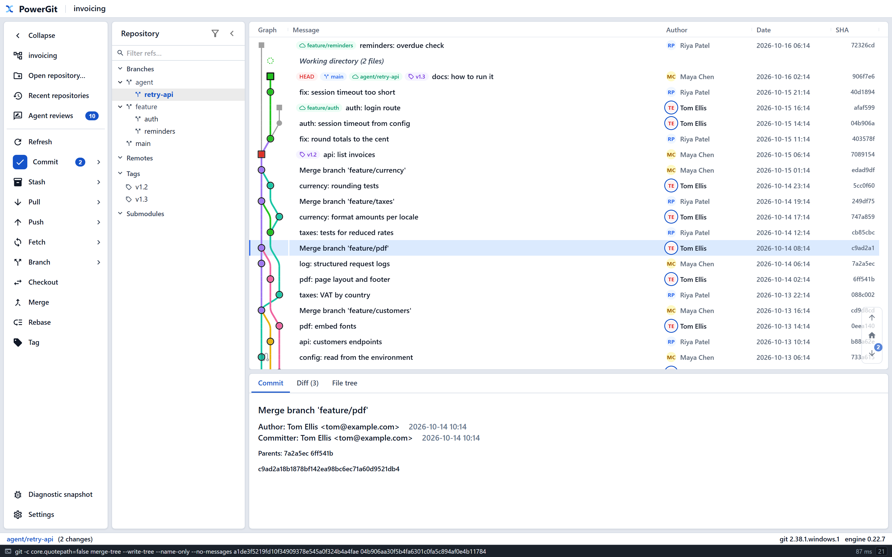

<h1 align="center">
  <br />
  PowerGit
</h1>

<p align="center">
  <b>A fast, portable git client for Windows and Linux, where your coding agents ask for your review.</b>
</p>

<p align="center">
  <a href="https://github.com/CynaCons/PowerGit/releases/latest"></a>
  
  
  <a href="LICENSE.md"></a>
</p>

<p align="center">
  <a href="https://cynacons.github.io/PowerGit/">Website and live demo</a> ·
  <a href="https://github.com/CynaCons/PowerGit/releases/latest">Download</a> ·
  <a href="docs/agents/mcp-agent-review.md">Agent integration docs</a>
</p>

<p align="center">
  
</p>

PowerGit is a desktop git client built on the revision graph of
[Git Extensions](https://github.com/gitextensions/gitextensions). It covers the
daily work: a complete graph, staging, merge, rebase, conflicts and the full
commit menu. It also runs an [MCP](https://modelcontextprotocol.io) server, so
Claude Code, Codex and other agents can bring their work to you:

- **Agent reviews.** The agent opens a review of its changes. You accept or
  reject each change, comment on lines, and send the round back. The agent
  revises until you approve, then commits.
- **Branch plans.** Before an agent rebases, merges or cherry-picks, it shows
  you the plan on your own graph. PowerGit checks every step with git and
  predicts conflicts before anything moves.
- **A channel to talk on.** While you review, you ask the agent questions and
  it answers on the line you asked about.

It runs locally. There is no account and no cloud service: reviews, plans
and the channel stay on your machine.

## Contents

- [Work with coding agents](#work-with-coding-agents)
- [Connect your agent](#connect-your-agent)
- [A complete git client](#a-complete-git-client)
- [Install](#install)
- [Troubleshooting](#troubleshooting)
- [Build from source](#build-from-source)
- [PowerGit and Git Extensions](#powergit-and-git-extensions)

## Work with coding agents

### Agent reviews

An agent calls `agent_review_open` with its changes: the working tree, a
range of commits, or patches. The review shows up in PowerGit's **Agent
reviews** inbox, from every repository you use.

- **A verdict per change.** Accept or reject each change, or mark single
  lines. A file shows how much of it is decided.
- **Comments on lines.** A comment goes back with the round. A question
  goes to the agent at once, and its answer appears under your line.
- **Rounds.** The agent revises and opens round 2. A change that did not
  move keeps your verdict, a revised one says so, and earlier conversations
  stay on their lines.
- **The agent explains itself.** The author can attach explanations to
  lines, such as why this approach or what it ruled out, and you reply in
  the same thread.
- **Other agents review too.** A second agent, for example Codex reviewing
  Claude's work, comments on lines beside you, and you keep or dismiss its
  comments.
- **Markdown documents.** A `.md` file switches between its changes and a
  rendered preview, and you comment directly on a paragraph, list or table.
- **Three modes.** *Wait* holds the agent until you decide. *Notify* leaves an
  item in your inbox while the agent goes on. *Silent* opens nothing.

<p align="center">
  
</p>

### Branch plans

An agent calls `branch_plan_open` with steps: rebase, branch, commit, merge,
cherry-pick, tag, delete, or open a pull request. PowerGit plays the plan on
the repository's real graph without moving a single ref:

- **A scrubber** steps through the plan. Planned commits are hollow, commits
  a rebase replaces are struck through, and each branch label moves to where
  the step leaves it.
- **Every step is checked with git.** Merges go through
  `git merge-tree`, and rebases and cherry-picks are replayed commit by commit.
  A predicted conflict names the file and shows both sides' change.
- **You approve or send it back,** with a comment on any step. Once
  approved, the agent runs the steps and PowerGit ticks each one as the refs
  move. If your branches move while the plan waits, PowerGit offers to check
  it again.
- **Pull requests from any host.** The agent reports each PR's id, title,
  state and link, from GitHub, Bitbucket, GitLab or your own server. The PR
  shows as a label on its branch and opens on click.

<p align="center">
  
</p>

### Talk while you review

With [PowerChannel](https://github.com/CynaCons/PowerChannel) installed, each
review and plan gets a channel. PowerGit shows whether the agent is reading
it. Questions, answers and round summaries go there, and you can message the
agent at any time from the review screen.

## Connect your agent

PowerGit must be running. The MCP endpoint is a private per-user pipe on
Windows, or a local socket on Linux. It holds no token on disk and accepts
nothing from the network.

**Claude Code**

```bash
claude mcp add powergit -- "C:\Users\<you>\AppData\Local\PowerGit\powergit.exe" mcp
```

**Codex** (`~/.codex/config.toml`)

```toml
[mcp_servers.powergit]
command = "C:/Users/<you>/AppData/Local/PowerGit/powergit.exe"
args = ["mcp"]
```

On Linux, use the AppImage's path instead. Any MCP client that speaks stdio
works the same way, with `powergit mcp` as the command.

| Tools | What the agent does with them |
| --- | --- |
| `agent_review_open`, `agent_review_wait`, `agent_review_get`, `agent_review_revise`, `agent_review_list`, `agent_review_cancel` | Open a review of its changes, wait for your verdicts, read your comments, open the next round |
| `agent_review_comment` | Review beside you as a second agent |
| `branch_plan_preview`, `branch_plan_open`, `branch_plan_wait`, `branch_plan_get`, `branch_plan_revise`, `branch_plan_cancel` | Check a plan without opening it, open it for you, see each step's check and whether it ran |
| `branch_plan_pr` | Attach a pull request from any host to a branch of the plan |

Payloads, the review loop and the channel protocol are documented in
[Agent review over MCP](docs/agents/mcp-agent-review.md).

## A complete git client

<p align="center">
  
</p>

- **The revision graph.** All branches, tags and stashes, with Git
  Extensions' lane colours and a lane layout checked against Git Extensions'
  own graph tests. It is virtualised, and was measured on a 100,000-commit
  repository. Follow the checked-out
  branch, highlight a commit's ancestry, show only chosen branches, and jump
  to HEAD, parent or child.
- **Staging.** The commit window has unstaged, staged, diff and message
  panes. Stage or reset whole files or selected lines, and it stays fast with
  thousands of changed files.
- **Merge, rebase and conflicts.** Fast-forward and squash merges, rebase and
  interactive rebase, cherry-pick and revert. An operation that stops on a
  conflict shows a banner with Resolve, Continue, Skip and Abort. Resolve
  file by file, or open your merge tool.
- **The full commit menu.** Checkout, branch, tag, cherry-pick, revert,
  reset, compare, save as patch, archive and open in browser, with Git
  Extensions' shortcuts.
- **Undo from the diff.** Select lines in a diff and reset just those, or
  reverse one change of an old commit into the working tree. Each reset says
  what it keeps before it runs.
- **Your own review.** Mark lines as reviewed in any diff and leave
  comments. The review survives restarts and exports to Markdown.
- **Tags, remotes and submodules.** Each tag shows whether a remote has it,
  and a local tag can be pushed. Remotes and submodules are managed from the
  repository tree.
- **Diffs.** Syntax highlighting, context lines, full file, whitespace and
  wrap options, a file list or a directory tree, and the full repository tree
  at any commit.
- **The git console.** One line at the bottom shows the last command, and a
  click opens every command PowerGit ran, with its output and exit code.
  Credentials never reach it.
- **Always current.** A watcher follows `.git`, so a commit from a terminal
  or an agent shows up at once.
- **Light and dark, zoom, keyboard.** Git Extensions' default shortcuts work,
  and letter keys never steal from the commit message.

## Install

| Platform | File | Notes |
| --- | --- | --- |
| Windows | `PowerGit_<version>_x64-setup.exe` | Installer, updates itself |
| Windows | `PowerGit_<version>_win64.zip` | Portable: unzip and run `powergit.exe` |
| Linux | `PowerGit_<version>_amd64.AppImage` | `chmod +x` and run; updates itself |

All files are on the [releases page](https://github.com/CynaCons/PowerGit/releases/latest).
PowerGit brings its own .NET git engine. It only needs `git` on `PATH`, and
on Linux the WebKitGTK stack (`libwebkit2gtk-4.1-0`, `libgtk-3-0`,
`libayatana-appindicator3-1`, `librsvg2-2`).

Ubuntu **22.04, 24.04 and 26.04** are supported. Each release AppImage is
launched in stock containers of all three before it is published. Other
distributions with WebKitGTK 2.40 or later should work, but are untested.

**Updates.** Settings → Updates → *Check for updates* asks GitHub for the
latest release, verifies its signature and installs it. PowerGit checks
nothing unless you press the button. The portable zip is replaced by hand.

`powergit <path>` opens that repository. Without a path, the last one
reopens.

## Troubleshooting

- **Diagnostic snapshot.** The rail's *Diagnostic snapshot* button writes
  one zip with the app's and engine's logs and state. Attach it to an
  [issue](https://github.com/CynaCons/PowerGit/issues).
- **A frozen window.** If the window stops responding or redrawing, the
  shell notices within about 20 seconds. It takes a snapshot, reloads the
  view, and offers to restart. Pressing *Diagnostic snapshot* twice does the
  same by hand.
- **Linux display problems.**
  - `POWERGIT_SOFTWARE_RENDER=1` turns off GPU rendering.
  - `POWERGIT_X11=1` runs under XWayland instead of native Wayland.
  - `POWERGIT_NO_FRAME_SYNC=1` turns off X11 frame sync.
  - See [docs/ubuntu-freeze.md](docs/ubuntu-freeze.md) for the recovery keys
    and `freeze-dump.sh`.
- **The app log.** Press Ctrl+Shift+\` to see what PowerGit recorded about
  itself, without developer tools.

## Build from source

Requirements: .NET 10 SDK, Node 22 and Rust.

```bash
# engine tests
dotnet test src/engine/PowerGit.Engine.sln

# UI dev server with the engine
cd frontend && npm ci && npm run dev:all

# unit and end-to-end tests
npm run test:unit
npm run test:e2e

# Windows artifacts into dist/
pwsh scripts/package-windows.ps1
```

All git I/O goes through the engine (`http://127.0.0.1:7733`, gated by a
bearer token); the UI never runs git itself. Contributor and agent guidance is
in [AGENTS.md](AGENTS.md), requirements in [docs/srs](docs/srs/README.md),
and the open plan in [PLAN.md](PLAN.md).

## PowerGit and Git Extensions

PowerGit is a new frontend, not a rewrite of git. It uses Git Extensions as
its behavioural reference, but shares no code with it:

- **The engine** is a small `net10.0` host around the git CLI.
- **The lane layout** is a TypeScript reimplementation of Git Extensions'
  `RevisionGraph`, verified against golden fixtures taken from Git
  Extensions' own tests (`tools/ge-parity/`).
- **The `powergit` branch** is the product. The upstream WinForms app is kept
  as a read-only mirror on `master`, as that reference.

|  | Git Extensions | PowerGit |
| --- | --- | --- |
| UI | Windows Forms | React and Material UI in a Tauri shell |
| Platforms | Windows | Windows and Linux |
| Install | Installer | Installer, portable zip, AppImage |
| Agents | None | MCP server: reviews, branch plans, channel |

## License

GPL-3.0. PowerGit is a combined work with Git Extensions; see
[LICENSE.md](LICENSE.md).
