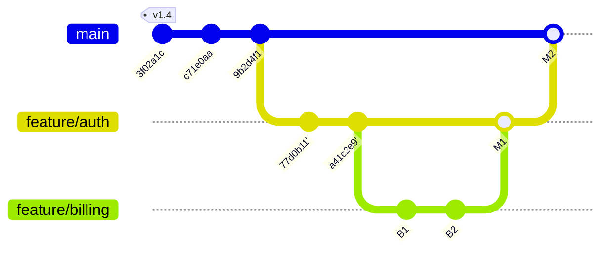

# Branch planner over MCP (draft, not requested)

Owner, 2026-10-24: "an MCP call or API that would enable to create an
ASCII-based Git tree. This way, I would be able to better plan my branch
management using this MCP with my agents. Like, they would show me how the
branches would look like. Like, which branch which commit, which base, how do
we merge, I would like some sort of like visual planner for branches. It's not
an official request because I don't know if we can make it work, but give it a
try and show me suggestions or possible designs for this."

This is a set of options to pick from, not an approved design.

## 1. The idea in one picture

An agent describes a plan ("rebase auth onto main, branch billing off it, two
commits, merge billing into auth, then auth into main"). PowerGit checks it
against the real repository, works out what the graph would become, asks git
which steps would conflict, and returns the picture. Nothing in the
repository moves.

```text
PLAN  rebase auth, stack billing, merge both          5 steps · 1 conflict risk

                v1.4
main            3f02a1c ── c71e0aa ── 9b2d4f1 ────────────────────────── ◇ M2 ⑤
                                         │                               │
feature/auth                             ╰─ ○ 77d0b11' ─ ○ a41c2e9' ──── ◇ M1 ④
                                              ⚠ ①        │               │
feature/billing                                          ╰─ ○ B1 ─ ○ B2 ─┘ ②③

 ① rebase feature/auth onto main         ⚠ conflict: src/session.ts (c71e0aa, 77d0b11)
 ② branch feature/billing from feature/auth
 ③ commit ×2 on feature/billing           planned, not checked
 ④ merge feature/billing → feature/auth  --no-ff   clean if ③ leaves auth alone
 ⑤ merge feature/auth → main             --no-ff   clean (git merge-tree)

 ── exists   ○ planned commit   ◇ planned merge   ' rebased copy   ⚠ predicted conflict
```

## 2. What PowerGit already has

- The commit graph with parents and refs (`/revisions`), branches, remote
  branches and tags (`/refs`), ahead and behind between two refs
  (`Divergence`), and the merge-base with the default branch (the v0.21.7
  branch-first ordering).
- Lane layout for the graph, but in the frontend (`frontend/src/graph/layout.ts`).
  An ASCII renderer would be new engine code (C#), or a port of that layout.
- git 2.38+ `merge-tree --write-tree`: a merge's result and its conflicted
  files, computed without a worktree. Rebase conflicts can be predicted the
  same way, one commit at a time (`merge-tree --merge-base`).
- The MCP host, its tool pattern, and the agent review's board and inbox,
  which a plan could reuse to be discussed and approved.

## 3. Picture styles

All four are generated from the same model. An agent picks with `style`.

### A. Like `git log --graph` (vertical, newest on top)

Familiar to every agent and developer; fits narrow chat panes; poor at
showing "this branch will move".

```text
*   ◇ M2  merge feature/auth → main            ⑤          main
|\
| *   ◇ M1  merge feature/billing → auth       ④          feature/auth
| |\
| | ○ B2  billing: invoices                     ③          feature/billing
| | ○ B1  billing: plan model                   ③
| |/
| ○ a41c2e9'  auth: refresh tokens              ①
| ○ 77d0b11'  auth: login form       ⚠ src/session.ts ①
|/
* 9b2d4f1  docs: release notes
* c71e0aa  fix: crash on empty repo
* 3f02a1c  release 1.4                                     (v1.4)
```

### B. Lanes (one row per branch, time left to right)

The planner's view: each branch is a line, its base is where it leaves its
parent, merges come back up. Best for "which base, how do we merge". Needs
the width of a wide pane; long runs of commits fold into `┄ 14 ┄`.

```text
                v1.4
main            3f02a1c ── c71e0aa ── 9b2d4f1 ────────────────────────── ◇ M2 ⑤
                   │                     │                               │
feature/auth       ╰╌ 77d0b11 ╌ a41c2e9  ╰─ ○ 77d0b11' ─ ○ a41c2e9' ──── ◇ M1 ④
                      replaced by ①           ⚠ ①        │               │
feature/billing                                          ╰─ ○ B1 ─ ○ B2 ─┘ ②③
```

### C. Table (branch by branch, then the steps)

Dense, sorts and diffs well, readable by an agent as easily as by the owner.
No picture of the shape.

```text
branch           base                 ahead behind  upstream               after the plan
main             —                       0      0    origin/main =          + M2 (merge auth)
feature/auth     main@3f02a1c            2      2    origin/feature/auth +1  rebased onto 9b2d4f1, + M1
feature/billing  (new) feature/auth      —      —    —                       + B1, B2, merged into auth

step  operation                                   check
①     rebase feature/auth onto main              ⚠ conflict in src/session.ts (c71e0aa vs 77d0b11)
②     branch feature/billing from feature/auth   ok, name is free
③     2 commits on feature/billing               planned
④     merge feature/billing into feature/auth    clean if ③ leaves auth's files alone
⑤     merge feature/auth into main (--no-ff)     clean
```

### D. Mermaid `gitGraph`

Renders as a real diagram wherever Markdown with Mermaid is shown (GitHub,
many chat clients, PowerGit's own Markdown if we add Mermaid). Cannot show a
rebase (only the result) or conflict marks.



Every style has an `ascii: true` variant (`*`, `o`, `M`, `!`, `|`, `/`, `\`,
`-`) for tools and fonts that misalign the box-drawing and circle characters.

## 4. The MCP tools

Three tools, in the order they could ship. Each is useful without the next.

### 4.1 `repo_graph` (read the real graph)

```text
repo_graph { repo_path, branches?: ["main", "feature/*"] | "local" | "all",
             since?: "v1.4" | "merge-base", max_commits?: 40, fold?: true,
             style?: "log" | "lanes" | "table" | "mermaid", ascii?: false }
→ { picture, branches: [{ name, tip, base, ahead, behind, upstream, upstream_ahead }],
    commits: [{ id, parents, refs, subject }] }
```

- `since: "merge-base"` starts at the oldest merge-base of the branches
  shown, so the picture is about the branches, not the history.
- `fold` turns runs of commits no branch starts from into `┄ n ┄`.
- The structured part lets the agent reason; the picture is for the owner.

What it gives straight away: "show me where my branches stand" in any chat,
with real data, before any planning exists.

### 4.2 `branch_plan_preview` (simulate a plan)

```text
branch_plan_preview { repo_path, title, steps: [
  { op: "rebase",      branch: "feature/auth", onto: "main" },
  { op: "branch",      name: "feature/billing", from: "feature/auth" },
  { op: "commit",      on: "feature/billing", label: "B1", subject: "billing: plan model",
                       files?: ["src/billing/plan.ts"] },
  { op: "merge",       from: "feature/billing", into: "feature/auth", mode: "no-ff" },
  { op: "merge",       from: "feature/auth", into: "main", mode: "no-ff" | "ff" | "squash" },
  { op: "cherry-pick", commits: ["c71e0aa"], onto: "release/1.4" },
  { op: "delete",      branch: "feature/billing" },
  { op: "tag",         name: "v1.5", at: "main" }
], style?, ascii? }
→ { picture_before, picture_after,
    steps: [{ n, op, result: "ok" | "conflict" | "unknown" | "invalid",
              files?: ["src/session.ts"], because?: "…" }],
    branches_after: [...] }
```

How it works, without touching the repository:

1. Load the commits involved (the branches named, down to their merge-bases).
2. Apply each step to an in-memory graph: a rebase copies the branch's
   commits onto the new base (`77d0b11'`), a merge adds a two-parent node, a
   squash adds one commit, `ff` moves the ref, a planned commit is a node with
   a label instead of an id.
3. Check each step against git where it can:
   - a merge or rebase between existing commits: `git merge-tree
     --write-tree` (per commit for a rebase) gives `clean` or `conflict` with
     the files;
   - a step that involves planned commits: `unknown`, unless the agent lists
     the planned commit's `files`, in which case an overlap with the other
     side's changed files is reported as a risk;
   - names, refs and order: `invalid` with the reason (branch exists,
     unknown ref, merging a branch into itself, deleting the current branch).
4. Render before and after in the asked style.

### 4.3 `branch_plan_open` (discuss and approve the plan in PowerGit)

Like an agent review, with the same inbox, board and rounds:

- The plan shows in PowerGit on the real graph: planned commits as hollow
  nodes, planned lanes dashed, rebased copies beside their originals, each
  step numbered on the graph and listed beside it with its check.
- The owner comments on a step ("merge billing with squash instead"),
  approves, or sends it back; the agent revises the plan (round 2).
- Approval is the owner's; the agent then runs the steps itself with git.

An optional later step, `branch_plan_apply`, would have PowerGit run an
approved plan's ref steps (branch, rebase, merge, tag, delete) one at a
time, stopping at the first conflict in its usual conflict screen. Not
proposed now: the agent can already run git, and an apply step is the part
that can lose work.

## 5. Recommended path

| Step | What ships | Size |
|---|---|---|
| 1 | `repo_graph`, styles `log`, `table`, `mermaid`, `ascii` variant | engine renderer + one MCP tool; small |
| 2 | `lanes` style for `repo_graph` | the hard renderer (lane packing, folding, width) |
| 3 | `branch_plan_preview`: steps, in-memory graph, `merge-tree` checks | medium; the conflict checks are the value |
| 4 | `branch_plan_open`: the plan on PowerGit's graph, rounds and board | large; reuses the agent review |

Step 1 alone already answers "show me which branch, which commit, which
base". Step 3 is where it becomes a planner. Step 4 makes it a shared,
approved plan.

## 6. To decide

1. Which picture reads best for you: A (log), B (lanes), C (table), or B for
   the plan with C under it (the sample in §1)?
2. Does the plan stay in the chat (steps 1–3), or should it also live in
   PowerGit for comments and approval (step 4)?
3. Should PowerGit ever run a plan (`branch_plan_apply`), or always leave
   that to the agent?
4. Name: `repo_graph` / `branch_plan_*`, or one `branch_planner` tool with
   `action: graph | preview | open`?
